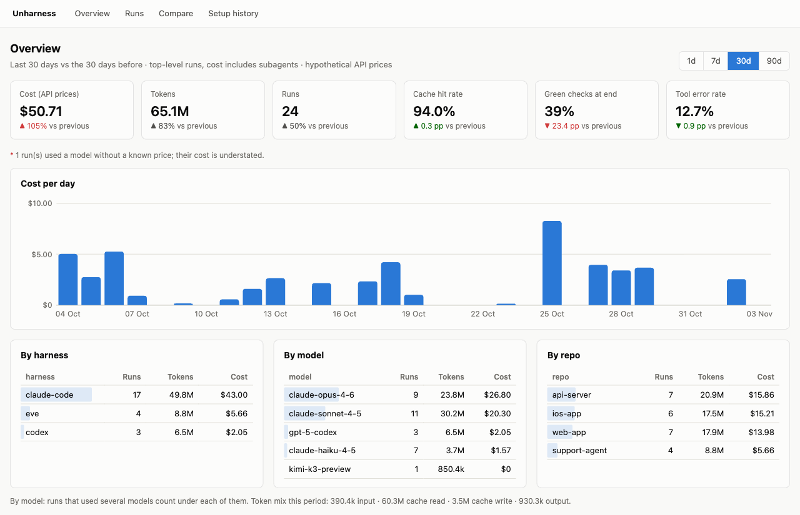

# Unharness

[](https://www.npmjs.com/package/@codelionapps/unharness)
[](LICENSE)

Local, metadata-only analytics for AI coding agent runs. Unharness reads the session logs of **Claude Code** and **Codex** (and receives traces from **eve**) and shows you how the agent worked: tokens, cache hit rate, tool calls and errors, which checks (tests, lint, typecheck) it ran and whether they passed, subagents, compactions, files touched, and what each run would have cost at API prices.

It never stores your prompts, the model's responses, tool arguments or results, shell commands, or file contents. Everything stays on your machine in SQLite.



## Who it's for

You use Claude Code or Codex every day and want answers to questions like:

- What do my sessions actually cost, and where does the money go (models, repos, subagents)?
- Is the prompt cache doing its job? How often does the agent compact, re-read files, or hit tool errors?
- Does the agent finish with green tests, and how many red runs does it need first?
- Did my last change to `CLAUDE.md`, a skill, an MCP server, or the model make runs better or worse?

Costs are always *hypothetical API-price costs*: what the same tokens would cost on the pay-as-you-go API, which is a useful common unit even if you are on a subscription.

## Contents

- [Privacy](#privacy)
- [Requirements and installation](#requirements-and-installation)
- [Quick start](#quick-start)
- [What you get](#what-you-get)
- [Configuration](#configuration)
- [eve integration](#eve-integration)
- [Updating](#updating)
- [Uninstalling](#uninstalling)
- [Troubleshooting](#troubleshooting)
- [Known limitations](#known-limitations)
- [Development](#development)
- [License](#license)

## Privacy

Unharness parses the session logs your agents already write to disk (`~/.claude/projects`, `~/.codex/sessions`) and keeps only metadata.

**What is stored**

- Per run: harness and version, repository name (from the `origin` remote, or the directory name), branch, start and end time, active time, your user name (the OS user name unless you set `UNHARNESS_USER`), and a machine id that is a hash of the hostname.
- Per model request: model, token counts (input, output, reasoning, cache read, cache write), and the computed cost.
- Per tool call: tool name and kind, MCP server name, status (ok, error, denied), duration, and an estimated size of the result in tokens.
- Checks: the class of a recognised check (for example `test:jest` or `typecheck:tsc`), the runner, exit code, pass or fail, and duration. The shell command is read in memory to classify it and then discarded.
- Skills invoked, subagents spawned, and compactions (with token counts before and after).
- Files read and edited, as paths **relative to the repository root**. Anything outside the repository is recorded only as `<outside-repo>`.
- A setup fingerprint: the *names and content hashes* of your agent configuration (`CLAUDE.md` / `AGENTS.md`, rules, skills, agents, commands, hooks, settings, MCP server definitions, model, harness version). Secret-looking keys such as `env`, `headers` or `token` are removed before hashing. File contents are never stored.

**What is never stored**

Prompts, responses, reasoning text, tool arguments and results, shell commands and their output, file contents, error messages, and absolute paths. The test suite includes a privacy canary that fails if any of these leak into the database.

**Where data lives**

In `~/.unharness/` (override with `UNHARNESS_HOME`): `db.sqlite` holds the runs, alongside cached pricing, your config, and the dashboard log. If you set up [profiles](#profiles-separate-databases-for-work-and-private-projects), each profile's `db.sqlite` lives in the directory you choose for it.

**Network calls**

Unharness has no telemetry. It makes exactly two kinds of outgoing requests, and neither sends anything about your sessions:

| What | Where | When |
|---|---|---|
| Model price table | `raw.githubusercontent.com` (LiteLLM's `model_prices_and_context_window.json`) | During `sync`, at most once a week. If it fails, the cached copy or a bundled snapshot is used. |
| Update check | `registry.npmjs.org` (latest version of `@codelionapps/unharness`) | At most once a day, only for interactive commands in a terminal. Skipped in CI, in a source checkout, and when `UNHARNESS_NO_UPDATE_CHECK=1` is set. |

The dashboard and the eve collector listen on `127.0.0.1` only. The dashboard rejects requests with a foreign `Host` header, and the collector rejects cross-origin browser requests.

## Requirements and installation

- Node.js 24 or newer (Unharness uses the built-in `node:sqlite`)
- macOS or Linux
- Claude Code and/or Codex (eve is optional)

```sh
npm i -g @codelionapps/unharness
```

Please install it globally rather than running it through `npx`. `unharness setup` writes hooks that call the CLI by its absolute path, and with `npx` that path is a temporary cache directory that can disappear at any time. Setup detects this and refuses to install hooks from the npx cache.

## Quick start

**1. Run setup** (interactive, in your own terminal):

```sh
unharness setup
```

It lists the agents it finds on your machine and, for each supported one, offers to install a hook that runs `unharness sync` in the background when a session ends. It then asks whether you want separate profiles (for example work and private), offers to install the Unharness skills, and runs a first sync that imports your existing sessions. `unharness setup --yes` accepts all defaults without asking.

**2. Work normally.** The hooks keep the database up to date. You can also import at any time with `unharness sync`.

**3. Open the dashboard:**

```sh
unharness dashboard
```

This starts the dashboard at <http://127.0.0.1:4319> in the background and opens it in your browser. Running the command again simply opens the browser on the instance that is already running. Stop it with `unharness dashboard --stop`.

**Or stay in the terminal:**

```sh
unharness runs --since 7d                 # recent runs
unharness run 3f2a                        # one run in detail (id or unique prefix)
unharness report --period 30d             # totals vs the previous 30 days
unharness compare --by model              # side-by-side metrics per model
unharness tag 3f2a exp:new-claude-md      # label a run for an experiment
unharness compare --by tag                # ...and compare tagged groups later
```

## What you get

### Dashboard

| Page | What it shows |
|---|---|
| **Overview** | Cost, tokens, runs, cache hit rate, share of runs ending with green checks, and tool error rate for 1, 7, 30 or 90 days, each compared with the previous period. Cost per day, plus breakdowns by harness, model and repository. |
| **Runs** | Every top-level run, filterable by harness, repository, tag and time window. |
| **Run detail** | Cost and token mix, context size per request with compactions marked, tools, checks in order (red and green), subagents as a tree with their own cost, skills, compactions, files touched, and the setup fingerprint. |
| **Compare** | Groups runs by harness, model, setup fingerprint or tag, and compares quality metrics and distributions (cost, tokens, tool errors and re-reads per run). Groups with fewer than 10 runs are flagged, because their differences may be noise. |
| **Setup history** | Each change to your agent setup, per harness and repository: which components were added, removed or changed, and how the runs after the change compare with the runs before it. |

When you have more than one profile, a switcher in the navigation lets you change profiles without restarting.

### CLI

```text
setup [--uninstall] [--yes]        detect agents, install sync hooks, configure profiles
sync [--reprice] [--rebuild [--yes]] [--verbose]
                                   import new sessions into the profile their project routes to
collect [--port 4318]              local OTLP/HTTP (JSON) collector for eve
runs [--harness] [--repo] [--tag] [--since 7d] [--limit 30]
run <id>                           run detail (id or unique prefix)
report [--period 1d|7d|30d|90d]    period aggregate vs the previous period
compare --by harness|setup|tag|model [--since 30d]
tag <run> <tag> [--rm]             add or remove an experiment tag
dashboard [--port 4319] [--stop]   local web dashboard in the background
export --format json|csv [--out f] export metadata (csv: runs only)

-p, --profile <name>               which profile's database to read
-v, --version
```

A few details worth knowing:

- Durations such as `--since` and `--period` accept hours, days or weeks: `24h`, `7d`, `4w`.
- `runs` and `report` also accept `--harness` and `--repo` filters.
- `run <id>` looks in every profile when you don't pass `-p`, so it finds a run wherever it was routed.
- `export --format json` dumps every metadata table; `--format csv` exports one row per run.

### Skills for your agent

`setup` can install two skills for Claude Code and Codex:

- **`unharness`** lets the agent answer questions like "how much did my sessions cost this week?" or "compare Opus and Sonnet runs" by calling the CLI.
- **`summarize-run`** (`/summarize-run`) syncs and summarizes the current session: cost, tokens, cache hit rate, tool calls and errors, subagents, skills, and checks.

## Configuration

### Profiles: separate databases for work and private projects

If you want to keep, say, company work and side projects apart, `unharness setup` can create profiles for you. The result is stored in `~/.unharness/config.json`:

```json
{
  "profiles": {
    "work": { "home": "~/.unharness" },
    "private": { "home": "~/.unharness-private" }
  },
  "routes": [
    { "path": "~/Code/company", "profile": "work" },
    { "path": "~/Code/side", "profile": "private" }
  ],
  "default": "work"
}
```

When `sync` imports a session, it chooses a profile in this order:

1. A `.unharness.json` file in the repository root: `{"profile": "private"}` sends the repository's runs to that profile, and `{"profile": null}` means "don't collect this repository at all".
2. The longest matching entry in `routes`.
3. `default`. Set it to `null` to skip every session that isn't covered by a route.

A git worktree (for example a Codex worktree under `~/.codex/worktrees`) also matches the `.unharness.json` and routes of its main checkout.

Read commands use `-p/--profile`, then the `UNHARNESS_PROFILE` environment variable, then `default`. `unharness dashboard -p private` restarts the dashboard on that profile.

Changing routes does not move runs that were already imported. To re-sort everything, run `unharness sync --rebuild`. It asks first, writes a `db.sqlite.bak` backup of each database, deletes the runs imported from logs, and imports them again. Manual tags are kept and eve runs are left alone. Sessions whose logs are already gone cannot be re-imported (Claude Code deletes transcripts after `cleanupPeriodDays`, 30 days by default).

### Custom check rules

Bash tool calls are classified into checks such as `test:jest`, `lint:eslint`, `typecheck:tsc`, `format:prettier` or `build:next`. Runners like `npm`, `yarn`, `pnpm` and `bun` are understood, and `package.json` scripts are expanded, so `npm test` counts as whatever `test` actually runs.

If your project uses something Unharness doesn't recognise, add rules globally in `~/.unharness/config.json` or per repository in `<repo>/.unharness.json`. `match` is a regular expression tested against each command segment:

```json
{ "checks": [{ "match": "^make verify\\b", "class": "test:make" }] }
```

Repository rules take precedence over global rules, which take precedence over the built-in ones. Rules only affect sessions imported after you add them.

### Pricing

Costs come from [LiteLLM's maintained price table](https://github.com/BerriAI/litellm/blob/main/model_prices_and_context_window.json), cached in `~/.unharness/pricing.json` and refreshed weekly during `sync`. A bundled snapshot is used when you are offline.

To correct or add a model price, create `~/.unharness/pricing-overrides.json` using LiteLLM's field names (costs are per token):

```json
{
  "my-custom-model": { "input_cost_per_token": 0.000003, "output_cost_per_token": 0.000015 }
}
```

Each request's cost is computed and stored when it is imported, together with the price table version used. After a price change, recompute everything with:

```sh
unharness sync --reprice
```

Runs that used a model missing from the table are marked with `*`, and their cost is understated.

### Environment variables

| Variable | Effect |
|---|---|
| `UNHARNESS_HOME` | Data directory (default `~/.unharness`). |
| `UNHARNESS_USER` | User name stored with each run (default: your OS user name). |
| `UNHARNESS_PROFILE` | Profile used by read commands when `-p` isn't given. |
| `UNHARNESS_NO_UPDATE_CHECK=1` | Disables the daily update check. |
| `UNHARNESS_CLAUDE_DIR` | Claude Code directory to read (default `~/.claude`). |
| `UNHARNESS_CODEX_DIR` | Codex directory to read (default `$CODEX_HOME`, then `~/.codex`). |

## eve integration

eve runs are not read from log files. Instead, Unharness runs a small local OpenTelemetry collector that eve sends traces to. Start it with:

```sh
unharness collect            # listens on http://127.0.0.1:4318/v1/traces
```

Then add `agent/instrumentation/unharness.ts` to your eve project:

```ts
import { otelIntegration } from 'eve/instrumentation/otel';
import { OTLPHttpJsonTraceExporter } from '@vercel/otel';

export default otelIntegration({
  traceExporter: new OTLPHttpJsonTraceExporter({ url: 'http://localhost:4318/v1/traces' }),
});
```

The collector accepts OTLP over HTTP with JSON only (not protobuf). It keeps a fixed whitelist of metadata attributes (ids, model, token usage, tool names, outcomes) and drops everything else before it reaches the database. Use `--port` to listen elsewhere, and `-p` to write into a specific profile.

## Updating

```sh
npm i -g @codelionapps/unharness@latest
```

Interactive commands tell you when a new version is available. After updating:

- Installed skills are refreshed automatically on the next `sync` (which the hooks run for you).
- The next `unharness dashboard` notices the new build and restarts the running dashboard.
- The database schema migrates automatically. If you go back to an older version, Unharness refuses to open a database created by a newer one instead of damaging it; update again to continue.

## Uninstalling

```sh
unharness setup --uninstall      # removes the Unharness hooks from Claude Code and Codex
```

This removes only Unharness's own hook entries and leaves the rest of your settings untouched (a backup of each changed file is written next to it as `*.unharness-bak`). It does not remove skills or data, so finish with:

```sh
rm -rf ~/.claude/skills/unharness ~/.claude/skills/summarize-run
rm -rf ~/.codex/skills/unharness ~/.codex/skills/summarize-run
rm -rf ~/.unharness              # plus any profile directories, e.g. ~/.unharness-private
npm rm -g @codelionapps/unharness
```

If you used Codex, setup also added a `[hooks.state."…"]` trust entry to `~/.codex/config.toml`. It is harmless once the hook is gone, but you can delete it.

## Troubleshooting

**"hook points at a missing node" warning.** Hooks call Node and the CLI by absolute path so they work without your shell's `PATH`. After a Node upgrade (for example with nvm) or a reinstall, that path can go stale and the hook silently stops importing. Unharness warns about this when you run a command in a terminal (and `setup` lists broken hooks too); re-run `unharness setup` and reinstall the hook to fix it.

**"port 4319 is taken by something else".** Start the dashboard on another port with `unharness dashboard --port 4400`. Use the same `--port` with `--stop`.

**The dashboard doesn't start.** The error shows the last lines of the log. The full log is at `~/.unharness/dashboard.log`.

**Codex runs don't show up.** Codex only runs hooks you have trusted. Setup trusts the Unharness hook automatically; if that fails, it tells you so. In that case open `codex`, run `/hooks`, and trust the Unharness hook. Editing the hook makes Codex distrust it again. The Codex hook runs after every turn (`Stop`), because Codex only fires `SessionEnd` when the app closes or has been idle for 30 minutes.

**Runs land in the wrong profile, or not at all.** `sync` prints how many sessions were not collected because no route matched. Check your `routes`, `default` and any `.unharness.json` files, then run `unharness sync --rebuild`.

**Some imports failed.** Run `unharness sync --verbose` to see why.

## Known limitations

- **Supported agents:** Claude Code, Codex and eve. opencode, Pi, Gemini CLI and Cursor are detected by `setup` but not supported yet.
- **Long-context pricing:** the higher price tier some models charge above 200k tokens of context is not applied, so those requests are underpriced.
- **Piped checks:** when a check isn't the last command in a pipeline (`jest | tail`), its exit code can't be observed. Unharness then judges pass or fail from common output patterns of popular runners, and otherwise records the result as unknown.
- **Setup fingerprints for older sessions:** a fingerprint describes your setup at the time a session is imported. For sessions backfilled by the first `sync`, that may not be the setup the run actually used. With the hooks installed, sessions are imported right after they end, so new fingerprints are accurate.
- **`/summarize-run`** covers the session up to the previous turn; the turn you are in is not included yet.
- **Estimates:** tool result sizes and skill sizes are estimated from character counts, and active time excludes gaps longer than 5 minutes.
- **Retention:** Unharness can only import logs that still exist. Claude Code deletes transcripts after `cleanupPeriodDays` (30 days by default), so install the hooks early.

## Development

```sh
git clone https://github.com/CodeLionApps/unharness.git
cd unharness
npm install
npm test               # node --test: adapter fixtures, queries, setup, privacy canary
npm run typecheck
./bin/unharness.js sync
./bin/unharness.js dashboard
```

The CLI runs directly from TypeScript sources on Node 24. In a source checkout, `unharness dashboard` rebuilds the dashboard automatically whenever its sources are newer than the last build. To try the dashboard with synthetic data, seed a scratch home and point Unharness at it:

```sh
node test/seed.ts /tmp/unharness-demo
UNHARNESS_HOME=/tmp/unharness-demo ./bin/unharness.js dashboard --port 4400
```

## License

[MIT](LICENSE)
